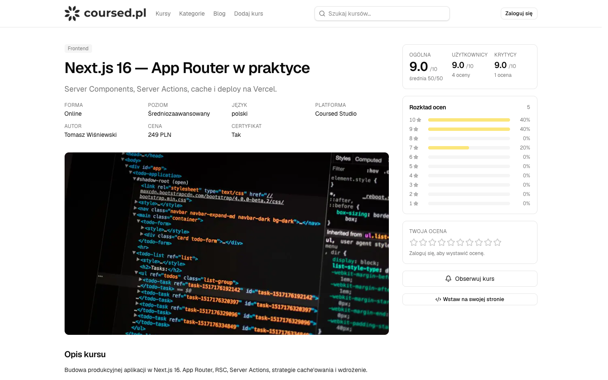
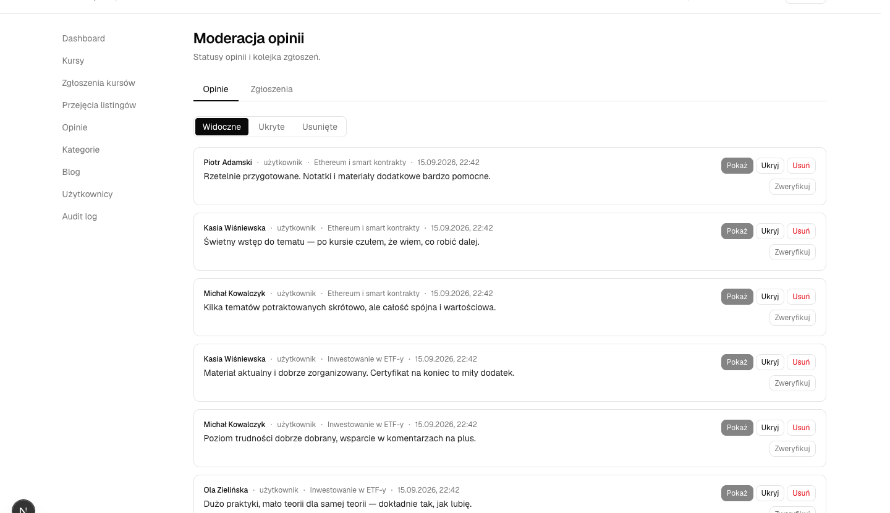
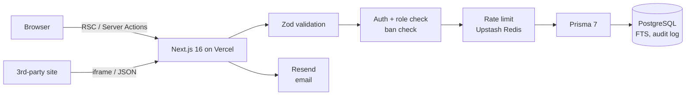

# coursed.pl

[](https://github.com/hefajstosu/coursed/actions/workflows/ci.yml)

**A review aggregator for online and offline courses — think “IMDb for courses”.**
Every course gets its own page with separate community and critic scores, written reviews, moderation and an embeddable rating widget.

**Live:** [coursed.pl](https://coursed.pl) (Polish UI)

| Home | Course page | Moderation panel |
| --- | --- | --- |
|  |  |  |

## Features

**For visitors and users**
- Course catalog with nested categories, filters (category, format, language, level) and sorting
- Full-text search with ranking, highlighted matches and autocomplete
- 1–10 ratings with optional aspect scores (content, instructor, value for money) and a rating histogram
- Written reviews with helpful / not helpful votes, abuse reports, “edited” marker and pagination
- Follow a course and get an email when a new review appears
- Public user profiles; GDPR self-service: JSON data export and account deletion
- Embeddable rating widget (`<iframe>`) and a CORS-enabled JSON endpoint for course owners

**For editors and admins** (`/admin`)
- Course CRUD, category tree, blog with Markdown
- Review moderation (hide / remove / verify), report queue, editorial responses to reviews
- Course submission queue, “claim this listing” flow for course creators
- Merging duplicate courses (moves ratings and reviews, resolves conflicts)
- User roles (USER / CRITIC / EDITOR / ADMIN) and bans
- Audit log of every moderation and admin action, with JSON diffs and filters

**SEO**
- JSON-LD (`Course`, `AggregateRating`, `Review`, `BreadcrumbList`, `ItemList`, `FAQPage`)
- Dynamic Open Graph images per course, category and blog post
- Sitemap with priorities derived from course popularity

## Tech stack

| Area | Choice |
| --- | --- |
| Framework | Next.js 16 (App Router, React Server Components, Server Actions), React 19, TypeScript (strict) |
| Data | PostgreSQL (Neon in production), Prisma 7 with the `pg` driver adapter |
| Auth | Auth.js v5 — Google OAuth + email magic links (Resend), database sessions |
| Validation | Zod 4 schemas shared by forms and Server Actions |
| Rate limiting | Upstash Redis (`@upstash/ratelimit`, sliding window) with an in-memory fallback |
| UI | Tailwind CSS v4, shadcn/ui on Base UI, lucide icons, sonner |
| Email | Resend REST API (magic links, moderation and follow notifications) |
| Testing / CI | Vitest, GitHub Actions (lint, typecheck, tests, migrations + build against Postgres) |
| Hosting | Vercel (`fra1`), migrations applied on every deploy |

## Architecture



Every mutation is a Server Action that follows the same pipeline: **validate input (Zod) → authenticate and authorize → rate-limit → write → write audit entry → `revalidatePath`**. Reads live in `src/server/queries`, writes in `src/server/actions`.

## Key technical decisions

- **Rating model.** The overall score is a 50/50 average of the user and critic averages, regardless of how many ratings each group has. A group below its minimum count (3 user ratings, 1 critic rating) is hidden instead of skewing the result, and the UI says when only one source exists. The pure logic lives in `src/lib/ratings.ts` and is unit-tested.
- **Denormalized rating cache.** Each course stores `cachedRatings` (JSONB), `avgOverall` and `ratingsCount`, so catalog pages can sort and filter without aggregating ratings. The cache is recomputed after every rating change inside a transaction guarded by a per-course `pg_advisory_xact_lock`, so concurrent ratings can't leave a stale value.
- **Search in Postgres, not an external service.** A `tsvector` column is maintained by a trigger with weighted fields (title > description/author > platform > body) and a GIN index; queries use `ts_rank` and `ts_headline`. The `simple` dictionary avoids wrong stemming of Polish word forms and proper names.
- **Database sessions instead of JWT.** Sessions are stored in Postgres so bans and role changes take effect immediately. `auth.config.ts` (providers, pages) is split from `auth.ts` (adapter, callbacks) to keep the Node-only Prisma adapter out of any edge bundle.
- **Authorization is checked where data is read.** The admin layout guards the UI, but every admin page and Server Action calls `requireRole()` itself, because layouts don't re-render on client-side navigation.
- **Abuse protection.** Per-action rate limits (ratings, reviews, votes, reports, submissions, magic-link emails per address and per IP), spam heuristics (link count, caps ratio with Polish letters, cross-course duplicates), honeypot fields and bans.
- **Google account linking.** `allowDangerousEmailAccountLinking` is enabled for Google only: Google verifies email ownership, so signing in with Google to an account created via magic link is safe and avoids the `OAuthAccountNotLinked` dead end.
- **Security headers.** HSTS, `nosniff` and a strict `frame-ancestors 'self'` everywhere except `/embed/*`, which is deliberately embeddable. JSON-LD is serialized with `<` escaped to prevent `</script>` injection, and outgoing email HTML is escaped.

## Project structure

```
src/
├── app/
│   ├── (public)/          # catalog, course pages, search, blog, profiles, legal pages
│   ├── (auth)/login/      # sign-in (Google, magic link, dev quick-login)
│   ├── admin/             # moderation and content management panel
│   ├── embed/[slug]/      # embeddable rating widget
│   └── api/               # Auth.js, embed JSON, search suggestions, GDPR export
├── components/            # UI grouped by domain (course, admin, site, ui)
├── lib/                   # ratings, rate limiting, spam, SEO, mailer, helpers
├── schemas/               # Zod schemas shared by forms and actions
└── server/
    ├── actions/           # Server Actions (mutations)
    └── queries/           # data access (reads)
prisma/                    # schema, migrations, demo seed
docs/                      # deployment guide, product notes, roadmap
```

## Running locally

Requirements: Node.js 20+, pnpm 10, PostgreSQL 16+.

```bash
pnpm install                 # also generates the Prisma client
cp .env.example .env         # set DATABASE_URL and AUTH_SECRET (pnpm dlx auth secret)
pnpm db:migrate              # apply migrations
pnpm db:seed                 # demo users, courses, ratings and reviews
pnpm dev                     # http://localhost:3000
```

Google and Resend keys are optional locally: in development the login page offers one-click sign-in as any seeded user (`/login`, disabled outside `NODE_ENV=development`).

## Scripts

| Command | Description |
| --- | --- |
| `pnpm dev` | Development server |
| `pnpm build` / `pnpm start` | Production build / server |
| `pnpm lint` | ESLint |
| `pnpm typecheck` | TypeScript, no emit |
| `pnpm test` / `pnpm test:watch` | Vitest unit tests |
| `pnpm db:migrate` / `pnpm db:deploy` | Create and apply migrations (dev) / apply only (prod) |
| `pnpm db:seed` | Demo data — never run against production |
| `pnpm db:studio` | Prisma Studio |

## Testing and CI

Unit tests cover the domain logic that is easy to get subtly wrong: the rating model, spam heuristics, slug generation, the open-redirect guard, the rate limiter and Zod schema regressions. GitHub Actions runs lint, typecheck and tests, then applies all migrations to a fresh Postgres 16 container and builds the app.

## Deployment and docs

- [docs/deployment.md](docs/deployment.md) — Vercel, Neon, Upstash, Resend and Google OAuth setup
- [docs/product.md](docs/product.md) — product concept and rating rules
- [docs/roadmap.md](docs/roadmap.md) — what's done and what's next (`#N` references in code comments point here)
